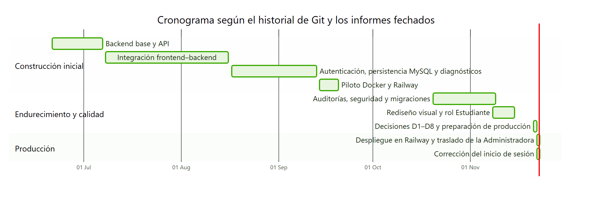

# 1. Presentación del proyecto

<!-- sub: Qué es el Sistema PIAR, para quién se construyó y cómo se organizó su desarrollo -->

## 1.1 Descripción general

El **Sistema PIAR** es una aplicación web para gestionar el **Plan Individual de Ajustes Razonables (PIAR/PR)** del **Colegio Reinaldo Matiz**. El PIAR es la herramienta que exige el Decreto 1421 de 2017 para planear y hacer seguimiento a los apoyos y ajustes razonables que necesita cada estudiante con discapacidad.

El sistema reúne en un solo lugar:

- el registro de estudiantes y docentes;
- la elaboración del PIAR, con sus barreras, ajustes razonables, evidencias y estrategias del Diseño Universal para el Aprendizaje (DUA);
- los diagnósticos, las observaciones y los seguimientos;
- el historial de versiones, los informes persistentes y un tablero de indicadores;
- la administración de cuentas con seis roles: Administrador, Rector, Coordinador, Psicólogo(a), Docente y Estudiante.

## 1.2 Datos del proyecto

Tabla: Ficha técnica del proyecto

| Elemento | Valor |
|---|---|
| Nombre | Sistema PIAR (PIAR-SISTEMA) |
| Institución beneficiaria | Colegio Reinaldo Matiz |
| Programa de formación | Tecnología en Análisis y Desarrollo de Software |
| Repositorio | `guido4574-jpg/PIAR-SISTEMA` (GitHub) |
| Rama de trabajo | `security/fase-1-hardening`, integrada en `main` |
| Versión documentada | Commit `6158d9a` (22 de noviembre de 2026) |
| Aplicación publicada | https://piar-sistema-production-99f3618b.up.railway.app |
| Tecnologías | Node.js 22 (`http` nativo), MySQL 8 (`mysql2`), HTML, CSS y JavaScript sin frameworks, Chart.js 4.5.1, Bootstrap Icons 1.13.1 |
| Plataforma de producción | Railway (servicio de aplicación y servicio MySQL en red privada) |

## 1.3 Convenciones de estado

Este documento separa con claridad lo que existe en el código, lo que se probó y lo que falta. Cada afirmación relevante lleva una de estas etiquetas:

Tabla: Etiquetas de estado usadas en el documento

| Etiqueta | Significado |
|---|---|
| [IMPLEMENTADO] | La funcionalidad existe en el código de la versión `6158d9a`. |
| [PROBADO LOCAL] | Se comprobó con pruebas automáticas o manuales en el equipo de desarrollo, sobre bases de datos de ensayo con datos sintéticos. |
| [PRODUCCIÓN] | Se verificó en el entorno publicado en Railway. |
| [PENDIENTE] | Falta configurarla, probarla o decidirla. |

> **Importante:** que una tabla exista en producción no significa que contenga datos ni que el flujo que la usa se haya ejecutado allí. Hasta la fecha de este documento no se ha demostrado en producción una creación o edición real de estudiantes y PIAR.

## 1.4 Metodología de desarrollo

El proyecto siguió un **modelo iterativo e incremental**. Cada iteración entregó una versión funcional y terminó con revisión y pruebas. La segunda etapa (octubre y noviembre de 2026) se organizó en ciclos de **auditoría → reparación → validación → publicación**, cada uno con autorización expresa antes de tocar producción.

Tabla: Comparación de metodologías consideradas

| Criterio | Cascada | Scrum | Kanban | Iterativo con auditorías (aplicado) |
|---|---|---|---|---|
| Requisitos | Fijos desde el inicio | Evolucionan por *sprint* | Evolucionan de forma continua | Evolucionan; se congelan antes de cada entrega |
| Entregas | Una al final | Al cierre de cada *sprint* | Continuas | Por fase, con versión funcional |
| Control de riesgos | Tardío | Por *sprint* | Por flujo | Auditoría previa y pruebas antes de cada publicación |
| Adecuación al equipo | Baja | Exige roles y ceremonias formales | Buena | Alta: equipo pequeño y decisiones institucionales que llegan por etapas |

**Justificación:** las reglas del PIAR y las decisiones institucionales (por ejemplo, quién crea las cuentas de estudiantes, D7) se fueron definiendo durante el proyecto. Un modelo en cascada no lo habría absorbido. Scrum completo exigía ceremonias que un equipo pequeño no podía sostener. El modelo aplicado tomó de Kanban el flujo continuo y añadió puntos de control obligatorios: auditoría, pruebas y autorización.

### Roles en el proyecto

Tabla: Roles del proyecto

| Rol | Responsabilidad |
|---|---|
| Desarrollo | Implementación del backend, el frontend, las migraciones y las pruebas |
| Revisión técnica y de seguridad | Auditorías de código, de dependencias y de configuración; verificación de resultados |
| Titular institucional | Decisiones D1–D9, autorización de cambios en producción y custodia de la cuenta Administradora |
| Personas usuarias | Personal docente y directivo que valida los flujos pedagógicos |

### Ciclo de vida aplicado

1. **Análisis:** requisitos del Decreto 1421 de 2017 y necesidades de la institución.
2. **Diseño:** modelo de datos, roles y permisos, arquitectura en capas.
3. **Construcción:** backend, frontend y migraciones versionadas.
4. **Pruebas:** unitarias, integración con MySQL real y flujos completos (e2e).
5. **Despliegue:** contenedor Docker en Railway con base de datos privada.
6. **Mantenimiento:** corrección de incidentes (por ejemplo, la demora del inicio de sesión) y procedimientos pendientes.

## 1.5 Cronograma real

Las fechas salen del historial de Git y de los informes fechados en `docs/historico/`.

Tabla: Fases, actividades y entregables

| Fase | Periodo | Actividades | Entregables |
|---|---|---|---|
| Construcción inicial | 21 jun – 20 sep 2026 | Backend base, integración con el frontend, autenticación, persistencia en MySQL, diagnósticos y piloto en Docker y Railway | Commits `fcd8c85` a `27a87f8` |
| Auditoría y endurecimiento | 20 oct – 15 nov 2026 | Auditorías técnicas, seguridad, migraciones versionadas, rediseño visual, rol Estudiante | Informes en `docs/historico/` |
| Cierre y producción | 21 – 22 nov 2026 | Decisiones D1–D9, 11 commits organizados por área, despliegue en Railway, traslado de la Administradora, corrección del inicio de sesión | Commits `f39137a` a `6158d9a`, producción en línea |

## 1.6 Organización de este documento

Los capítulos 2 a 5 presentan el problema, los objetivos y el alcance. Los capítulos 6 a 12 describen requisitos, diseño, datos y módulos. Los capítulos 13 a 20 son los manuales técnico, de usuario, de seguridad, de API, de pruebas, de despliegue y de mantenimiento. Los capítulos 21 a 24 cierran con limitaciones, glosario, conclusiones y referencias.
