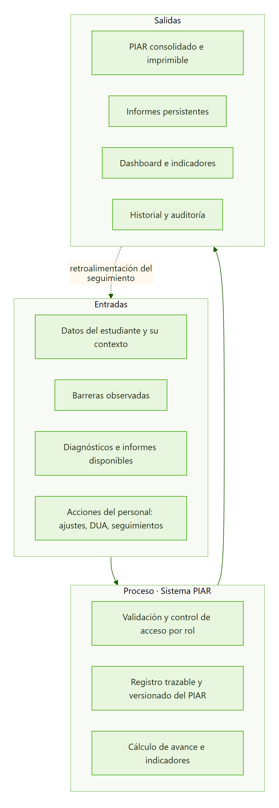

# 2. Planteamiento del problema

<!-- sub: La necesidad institucional que atiende el sistema -->

## 2.1 Descripción del problema

El Decreto 1421 de 2017 obliga a las instituciones educativas a elaborar un PIAR para cada estudiante con discapacidad. El plan debe describir al estudiante y su contexto, identificar las barreras para el aprendizaje y la participación, definir los ajustes razonables por área, hacerles seguimiento y entregarse de un año al siguiente.

Cuando ese trabajo se lleva en documentos sueltos y hojas de cálculo, aparecen problemas conocidos:

- **Dispersión:** la información de un estudiante queda repartida entre docentes, orientación y coordinación.
- **Falta de trazabilidad:** no queda registro de quién cambió el plan, cuándo ni por qué.
- **Ajustes desconectados:** los ajustes razonables no se vinculan con la barrera que los origina ni con evidencias de su aplicación.
- **Control de acceso débil:** datos sensibles de menores de edad (diagnósticos, informes de salud) quedan al alcance de personas que no los necesitan.
- **Seguimiento difícil:** sin indicadores consolidados, la coordinación no sabe qué planes están atrasados.

## 2.2 Contexto

El sistema se construyó para el **Colegio Reinaldo Matiz**, una institución educativa colombiana. En el proceso participan perfiles con responsabilidades distintas: la dirección (Rector), la coordinación académica, el área de orientación o psicología, los docentes de aula y la administración del sistema. El propio estudiante puede consultar su plan cuando la institución lo autoriza con el consentimiento del acudiente.

## 2.3 Necesidades de las personas usuarias

Tabla: Necesidades por perfil

| Perfil | Necesidad principal |
|---|---|
| Docente | Registrar barreras, ajustes, evidencias y seguimientos solo de los estudiantes que tiene a cargo |
| Coordinador | Supervisar todos los PIAR, cerrar y reabrir periodos, asignar docentes |
| Psicólogo(a) | Registrar diagnósticos y observaciones sin modificar el plan pedagógico |
| Rector | Consultar el estado general e intervenir en estudiantes, docentes y planes |
| Administrador | Controlar quién accede, aprobar solicitudes y gestionar las cuentas |
| Estudiante | Conocer su propio plan sin ver información clínica ni profesional |

## 2.4 El sistema visto con la teoría general de sistemas

El PIAR funciona como un sistema abierto: recibe información del estudiante y del personal, la procesa con reglas de validación y permisos, y produce planes, informes e indicadores que retroalimentan el seguimiento.

## 2.5 Procesos principales

Tabla: Procesos del sistema con sus entradas y salidas

| Proceso | Entradas | Salidas | Responsable |
|---|---|---|---|
| Gestión de cuentas | Solicitud o datos de la cuenta, decisión del Administrador | Cuenta activa o rechazada, auditoría | Administrador |
| Caracterización del estudiante | Datos personales, contexto, fortalezas, apoyos | Registro del estudiante | Administrador, Rector, Coordinador |
| Elaboración del PIAR | Estudiante, periodo, docentes, componentes pedagógicos | PIAR en borrador o activo, versión inicial | Administrador, Rector, Coordinador, Docente asignado |
| Barreras y ajustes | Barrera por contexto, ajuste vinculado, evidencias, estrategias DUA | Plan de ajustes trazable con avance | Docente asignado y directivos |
| Seguimiento | Observaciones, seguimientos, diagnósticos | Registros inmutables, alertas en el tablero | Coordinador, Psicólogo(a), Docente |
| Cierre y reporte | Decisión de cierre, solicitud de informe | PIAR en solo lectura, informe con instantánea | Administrador, Rector, Coordinador |
