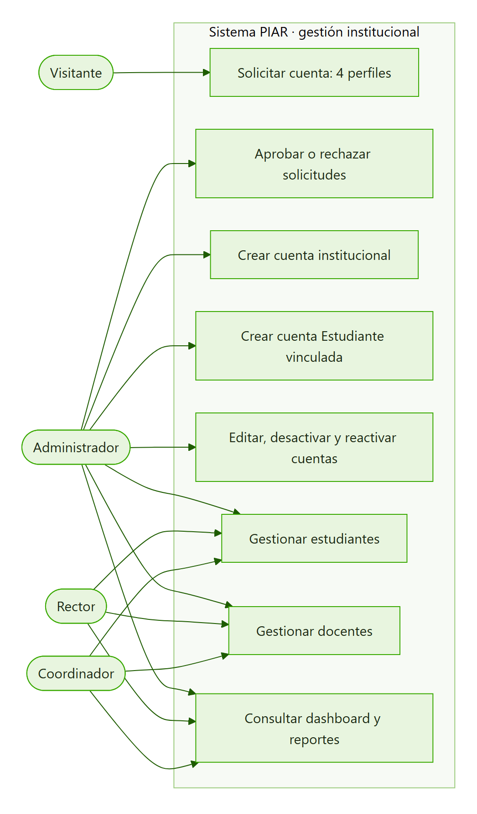
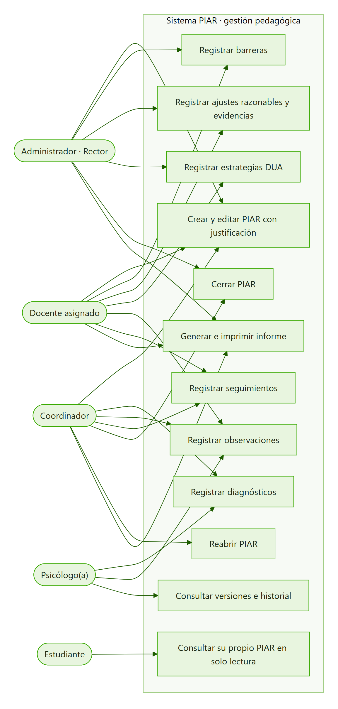

# 7. Historias de usuario y casos de uso

<!-- sub: Cómo usan el sistema los seis perfiles -->

## 7.1 Historias de usuario

Tabla: Historias de usuario con criterios de aceptación

| ID | Historia | Criterios de aceptación | Estado |
|---|---|---|---|
| HU-01 | Como **Docente**, quiero solicitar una cuenta para acceder al sistema sin depender de que alguien la cree por mí. | El formulario ofrece cuatro perfiles; la cuenta queda pendiente hasta verificar el correo y ser aprobada; antes de eso no puede ingresar. | [PROBADO LOCAL] |
| HU-02 | Como **Administrador**, quiero aprobar o rechazar solicitudes para controlar quién accede a datos de menores. | Solo ve solicitudes con el correo verificado; el rechazo exige motivo; la decisión queda auditada. | [PROBADO LOCAL] |
| HU-03 | Como **Coordinador**, quiero crear el PIAR de un estudiante y asignarle docentes para iniciar el proceso del periodo. | Título, periodo y año obligatorios; los docentes asignados ven el plan; queda la versión inicial. | [PROBADO LOCAL] |
| HU-04 | Como **Docente asignado**, quiero registrar una barrera y el ajuste razonable que la atiende para que el plan sea trazable. | El ajuste solo acepta barreras del mismo PIAR; el avance va de 0 a 100; un docente no asignado recibe 403. | [PROBADO LOCAL] |
| HU-05 | Como **Docente**, quiero registrar evidencias y seguimientos para demostrar que el ajuste se aplica. | Las evidencias quedan ligadas al ajuste; los seguimientos no pueden editarse después. | [PROBADO LOCAL] |
| HU-06 | Como **Psicólogo(a)**, quiero registrar diagnósticos y observaciones sin poder modificar el plan pedagógico. | Puede crear y editar diagnósticos y crear observaciones; recibe 403 al editar el PIAR o los ajustes. | [PROBADO LOCAL] |
| HU-07 | Como **Coordinador**, quiero cerrar el PIAR al final del periodo y reabrirlo si hace falta. | Un PIAR cerrado responde 409 a toda escritura; solo el Coordinador reabre, con justificación. | [PROBADO LOCAL] |
| HU-08 | Como **Rector**, quiero consultar el tablero y generar informes para conocer el estado de la inclusión en la institución. | El tablero muestra totales y alertas; el informe guarda una instantánea consultable después. | [PROBADO LOCAL] |
| HU-09 | Como **Estudiante**, quiero consultar mi PIAR para conocer los apoyos que recibo. | Solo ve su propio plan, sin diagnósticos, observaciones, seguimientos ni informes de salud; un PIAR ajeno responde 404. | [PROBADO LOCAL] |
| HU-10 | Como **cualquier usuario**, quiero recuperar mi contraseña si la olvido. | El enlace vence en 30 minutos y sirve una vez; la respuesta no revela si el correo existe. | [PROBADO LOCAL] · [PENDIENTE] en producción |

## 7.2 Diagramas de casos de uso

El primer diagrama reúne la gestión institucional: cuentas, estudiantes, docentes y tablero.

El segundo diagrama reúne la gestión pedagógica del PIAR.

## 7.3 Especificación de casos de uso principales

### CU-01 Iniciar sesión

Tabla: Caso de uso CU-01

| Campo | Descripción |
|---|---|
| Actor | Cualquier persona con cuenta |
| Precondición | La cuenta existe y está activa |
| Flujo principal | 1. Escribe correo y contraseña. 2. Pulsa **Iniciar sesión**; el botón muestra «Ingresando…». 3. El servidor valida límites de intentos y credenciales. 4. Crea la sesión y envía la cookie. 5. La interfaz muestra el panel de su rol. |
| Flujo alterno | Credenciales inválidas, cuenta pendiente, rechazada o desactivada: mensaje genérico «Correo o contraseña incorrectos» y botón restablecido. Demasiados intentos: bloqueo temporal (429). |
| Postcondición | Sesión registrada en `sesion_usuario` con vencimiento de 8 horas |

### CU-02 Crear y editar un PIAR

Tabla: Caso de uso CU-02

| Campo | Descripción |
|---|---|
| Actores | Administrador, Rector, Coordinador; Docente solo en los PIAR asignados (editar) |
| Precondición | El estudiante existe y está activo |
| Flujo principal | 1. Abre **PIAR / PR → Nuevo PIAR**. 2. Elige estudiante, título, periodo, año y docente responsable. 3. Guarda: se crea el PIAR y su versión inicial. 4. Para editar, cambia los campos y escribe una justificación. 5. El servidor guarda la nueva versión con valores anteriores y nuevos. |
| Flujo alterno | Falta título, periodo o año: error de validación. PIAR cerrado: 409. Docente no asignado: 403. |
| Postcondición | PIAR registrado y versión en `historial` e `historial_detalle` |

### CU-03 Registrar barrera y ajuste razonable

Tabla: Caso de uso CU-03

| Campo | Descripción |
|---|---|
| Actores | Docente asignado, Coordinador, Rector, Administrador |
| Precondición | PIAR abierto (no cerrado) |
| Flujo principal | 1. En el detalle del PIAR, registra la barrera con su contexto y fecha. 2. Registra el ajuste: área, tipo, estrategia, barrera vinculada, responsable, resultado esperado e indicador. 3. Actualiza el avance (0–100) y agrega evidencias. |
| Flujo alterno | Barrera de otro PIAR: rechazada por la validación y por la clave foránea compuesta. Avance fuera de rango: rechazado (`CHECK` en MySQL). |
| Postcondición | Ajuste trazable a su barrera; el avance alimenta el tablero |

### CU-04 Crear cuenta Estudiante

Tabla: Caso de uso CU-04

| Campo | Descripción |
|---|---|
| Actor | Administrador |
| Precondición | El estudiante existe, está activo y no tiene cuenta; la institución tiene la autorización del acudiente |
| Flujo principal | 1. **Usuarios → Nueva cuenta**, perfil «Estudiante». 2. Elige el estudiante; se rellenan nombre, apellidos y documento. 3. Marca la autorización del acudiente, escribe correo y contraseña temporal. 4. El servidor crea la cuenta, la vincula y audita, todo en una transacción. |
| Flujo alterno | Sin autorización o con cuenta existente: rechazo sin cambios. |
| Postcondición | Tras verificar el correo, el estudiante ingresa y debe cambiar la contraseña |
