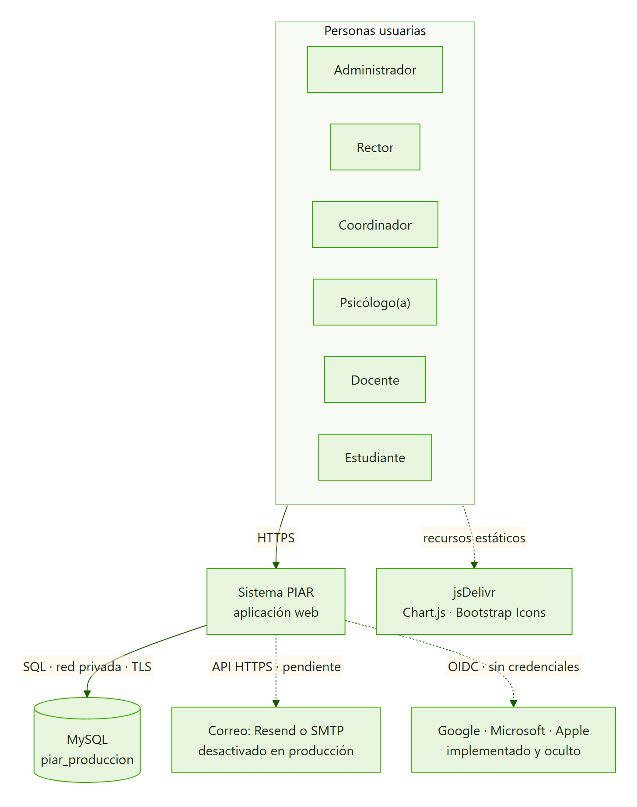
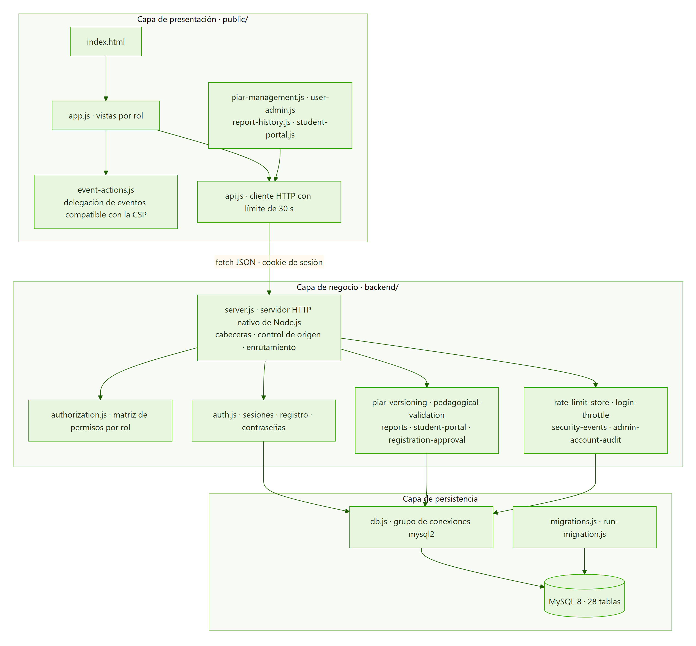
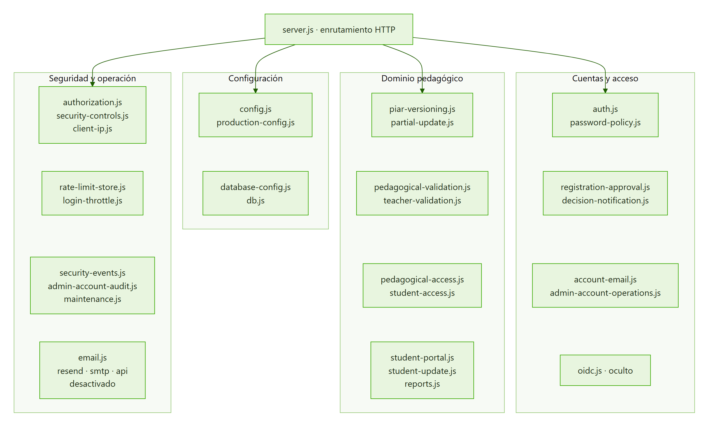
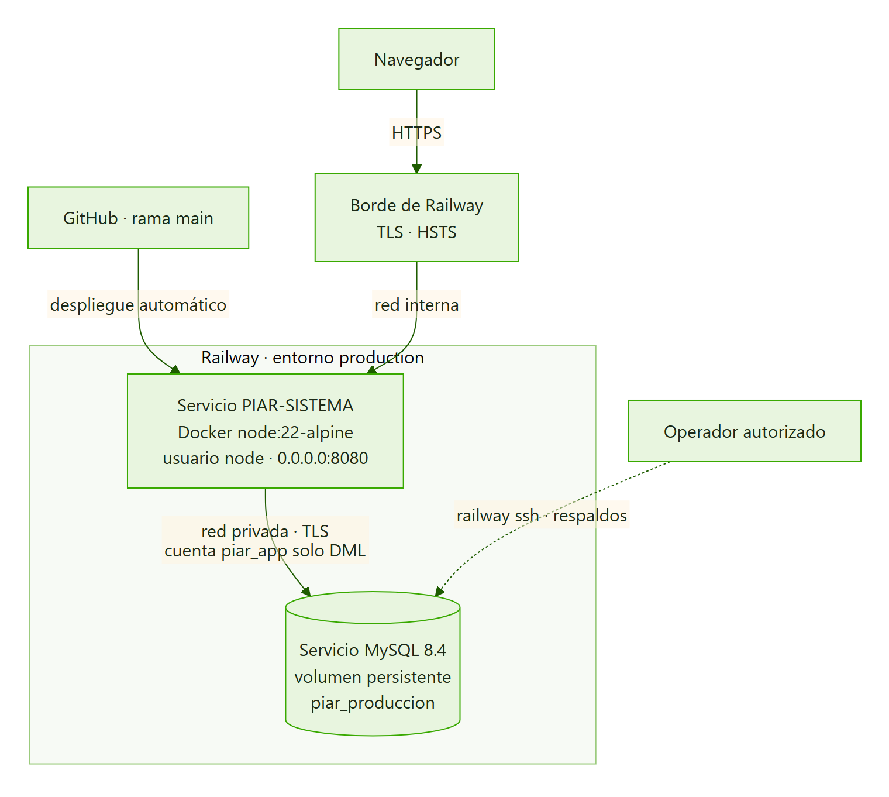

# 8. Arquitectura del sistema

<!-- sub: Estilo arquitectónico, capas, componentes y tecnologías -->

## 8.1 Tipo de arquitectura

El sistema sigue una arquitectura **cliente-servidor en tres capas**, desplegada como **monolito modular**:

- **Presentación:** aplicación de una sola página en HTML, CSS y JavaScript sin frameworks (`public/`).
- **Negocio:** servidor HTTP nativo de Node.js con módulos especializados (`backend/`).
- **Persistencia:** MySQL 8 con un grupo de conexiones `mysql2` y migraciones versionadas.

**Justificación:** un monolito modular es suficiente para el volumen de una institución educativa, simplifica el despliegue (un contenedor y una base de datos) y evita la complejidad de los microservicios. La separación en módulos permite probar cada regla de forma aislada (44 archivos de pruebas unitarias).

## 8.2 Capas del sistema

Tabla: Responsabilidades por capa

| Capa | Ubicación | Responsabilidad | Componentes clave |
|---|---|---|---|
| Presentación | `public/` | Vistas por rol, formularios, gráficas, consumo de la API | `index.html`, `app.js`, `api.js`, `event-actions.js`, `piar-management.js`, `user-admin.js`, `report-history.js`, `student-portal.js` |
| Negocio | `backend/` | Enrutamiento, autenticación, autorización, validación, reglas del PIAR, correo, auditoría | `server.js`, `auth.js`, `authorization.js`, `piar-versioning.js`, `pedagogical-validation.js`, `reports.js`, `email.js` |
| Persistencia | `backend/db.js`, `database/migrations/` | Conexiones, transacciones, esquema versionado | `db.js`, `migrations.js`, `run-migration.js`, migraciones 000–016 |

## 8.3 Componentes del backend

El backend tiene 37 archivos en `backend/`. El diagrama los agrupa por responsabilidad.

## 8.4 Patrones de diseño aplicados

Tabla: Patrones y su aplicación

| Patrón | Aplicación en el código |
|---|---|
| Enrutador central (*Front Controller*) | `server.js` recibe todas las peticiones, aplica cabeceras, control de origen, sesión y autorización antes de llegar al manejador |
| Matriz de autorización declarativa | `authorization.js` define permisos por rol, método y ruta, con denegación por omisión |
| Estrategia (*Strategy*) | `email.js` elige el transporte (`resend`, `smtp`, `api`, `memory`, `desactivado`) según `EMAIL_TRANSPORT`, con una única función `deliverEmail` |
| Grupo de conexiones (*Pool*) | `db.js` reutiliza conexiones y ofrece transacciones |
| Migraciones versionadas | Cada cambio de esquema es un archivo numerado con checksum; `schema_migrations` evita aplicar dos veces o aplicar un archivo alterado |
| Delegación de eventos | `event-actions.js` ejecuta acciones declaradas con `data-on*` desde una lista permitida, lo que permite una CSP sin scripts en línea |
| Proyección de datos | `student-portal.js` devuelve al Estudiante una vista reducida del PIAR sin campos sensibles |

## 8.5 Tecnologías utilizadas

Tabla: Tecnologías por capa

| Capa | Tecnología | Versión | Uso |
|---|---|---|---|
| Frontend | HTML5, CSS3, JavaScript (ES2022) | — | Interfaz sin frameworks |
| Frontend | Chart.js | 4.5.1 (jsDelivr con SRI) | Gráficas del tablero |
| Frontend | Bootstrap Icons | 1.13.1 (jsDelivr con SRI) | Iconografía. **No** se usa Bootstrap CSS ni JS |
| Frontend | Poppins | Alojada localmente | Tipografía |
| Backend | Node.js | 22.20 (motor `>=22 <23`) | Servidor HTTP nativo |
| Backend | bcryptjs | ^3.0.2 | Hash de contraseñas |
| Backend | mysql2 | ^3.24.6 | Cliente MySQL con consultas parametrizadas |
| Backend | nodemailer | ^10.6.1 | Transporte SMTP |
| Backend | openid-client | ^6.9.1 | OpenID Connect (implementado y oculto) |
| Base de datos | MySQL | 8.0.46 en local, 8.4.13 en producción | Persistencia |
| Infraestructura | Docker | `node:22-alpine` | Imagen de producción |
| Infraestructura | Railway | Plan Trial | Hospedaje de la aplicación y de MySQL |
| Correo | Resend | API HTTPS | Transporte previsto (D9); desactivado en producción |
| Control de versiones | Git y GitHub | — | Repositorio `guido4574-jpg/PIAR-SISTEMA` |

## 8.6 Arquitectura de despliegue

El navegador se conecta por HTTPS al borde de Railway, que termina TLS y reenvía la petición al contenedor por la red interna. El contenedor escucha en `0.0.0.0:8080` y se conecta a MySQL por la red privada con TLS, usando la cuenta `piar_app`, que solo tiene permisos de manipulación de datos (DML). MySQL no está expuesto a Internet. Cada cambio en la rama `main` de GitHub dispara un despliegue automático.

## 8.7 Integración y tecnologías emergentes

**Integración de capas:** la interfaz consume la API con `fetch` y la cookie de sesión. El servidor valida, autoriza y persiste en MySQL dentro de transacciones cuando la operación toca varias tablas. Los servicios web externos son tres: jsDelivr (recursos estáticos con SRI), Resend (API HTTPS de correo, preparada) y los proveedores OpenID Connect (implementados y ocultos).

**Tecnología emergente aplicable — inteligencia artificial asistida:** un modelo de lenguaje podría sugerir ajustes razonables y estrategias DUA a partir de las barreras registradas, o resumir la evolución del estudiante para el informe anual. **No está implementado.** Antes de adoptarlo habría que resolver tres condiciones: que ningún dato personal de menores salga de la institución sin base legal (Ley 1581 de 2012), que toda sugerencia sea revisada y aprobada por un profesional, y que la trazabilidad registre qué parte del plan fue sugerida.
