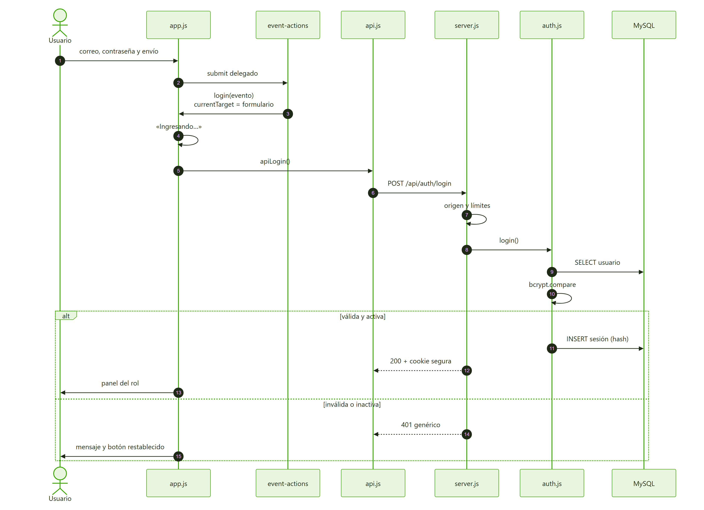
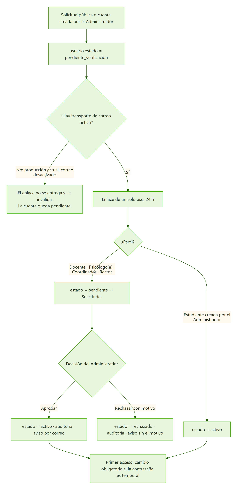
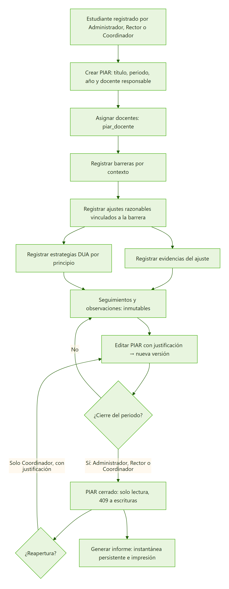
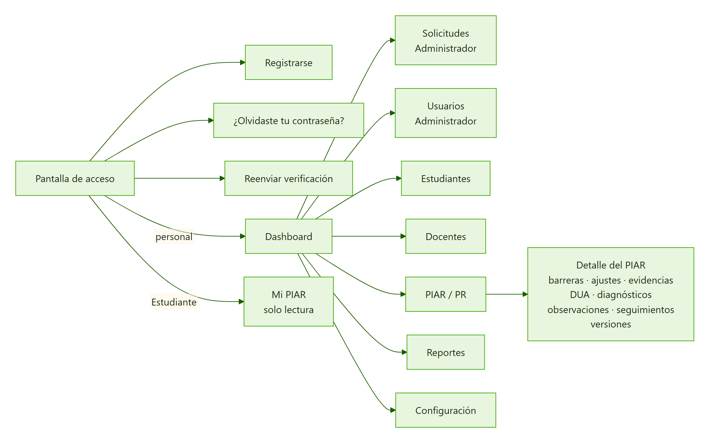

# 9. Diagramas UML y de procesos

<!-- sub: Secuencias y flujos derivados del código -->

## 9.1 Secuencia de inicio de sesión

Este diagrama refleja el flujo corregido en el commit `6158d9a`. El despachador de eventos entrega a la función `login` un evento cuyo `currentTarget` es el formulario. Antes de la corrección era `document`, y el botón quedaba bloqueado en «Ingresando…».

Puntos de seguridad del flujo:

- El servidor compara la contraseña contra un hash ficticio aunque la cuenta no exista, para que el tiempo de respuesta no revele qué correos están registrados.
- El token de sesión se guarda como hash: si alguien leyera la tabla `sesion_usuario`, no podría suplantar sesiones.
- El cliente cancela la petición a los 30 segundos (`AbortController`) para no dejar la interfaz bloqueada.

## 9.2 Flujo de registro y aprobación de cuentas

> **Atención:** con el correo desactivado en producción, el enlace de verificación no se entrega y se invalida. Las cuentas nuevas quedan en `pendiente_verificacion`. Este flujo solo funcionará en producción cuando se configure Resend.

## 9.3 Ciclo de vida del PIAR

Tabla: Estados y reglas del PIAR

| Situación | Regla | Componente |
|---|---|---|
| Creación | Título, periodo y año obligatorios; se crea la versión inicial | `pedagogical-validation.js`, `piar-versioning.js` |
| Edición | Exige justificación; guarda el valor anterior y el nuevo en JSON | `piar-versioning.js` |
| Campo opcional vacío | Se guarda como `NULL` (no se conserva el valor anterior por omisión) | `partial-update.js` |
| Cierre | `estado = 'cerrado'` y `fecha_cierre` con la fecha actual; toda escritura posterior de contenido responde 409 | `server.js`, `piar-versioning.js` |
| Reapertura | Solo el Coordinador, con justificación; el PIAR pasa a `estado = 'revision'` y se borra `fecha_cierre` | `server.js`, `authorization.js` |
| Informe | El servidor arma una instantánea y guarda su hash en `reporte` | `reports.js` |

## 9.4 Mapa de navegación

El menú lateral solo muestra las secciones que el rol puede usar. El Docente ve seis secciones y el Estudiante solo «Mi PIAR». Ocultar una sección es una ayuda de usabilidad: la protección real la aplica el servidor.
