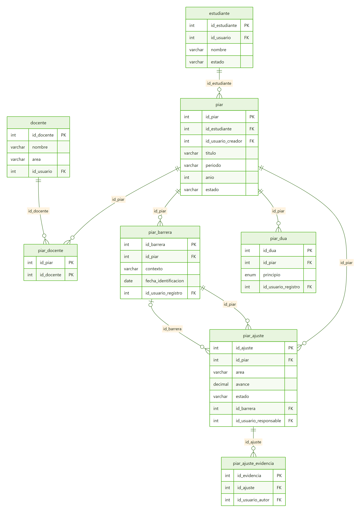
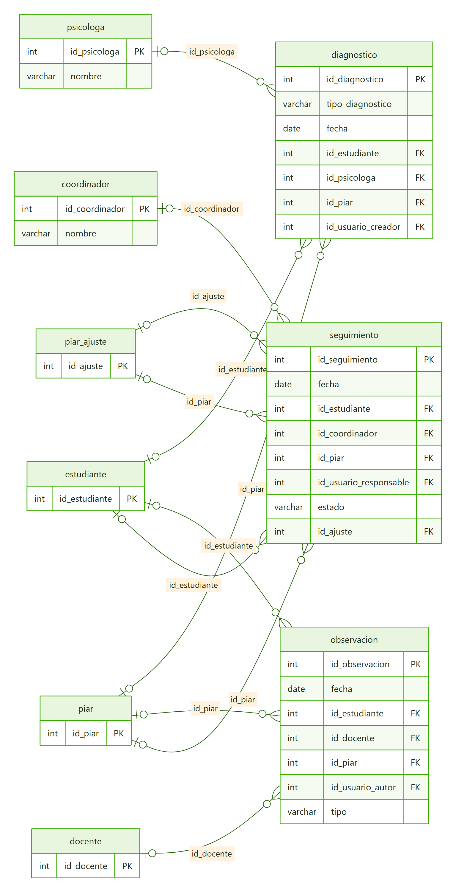
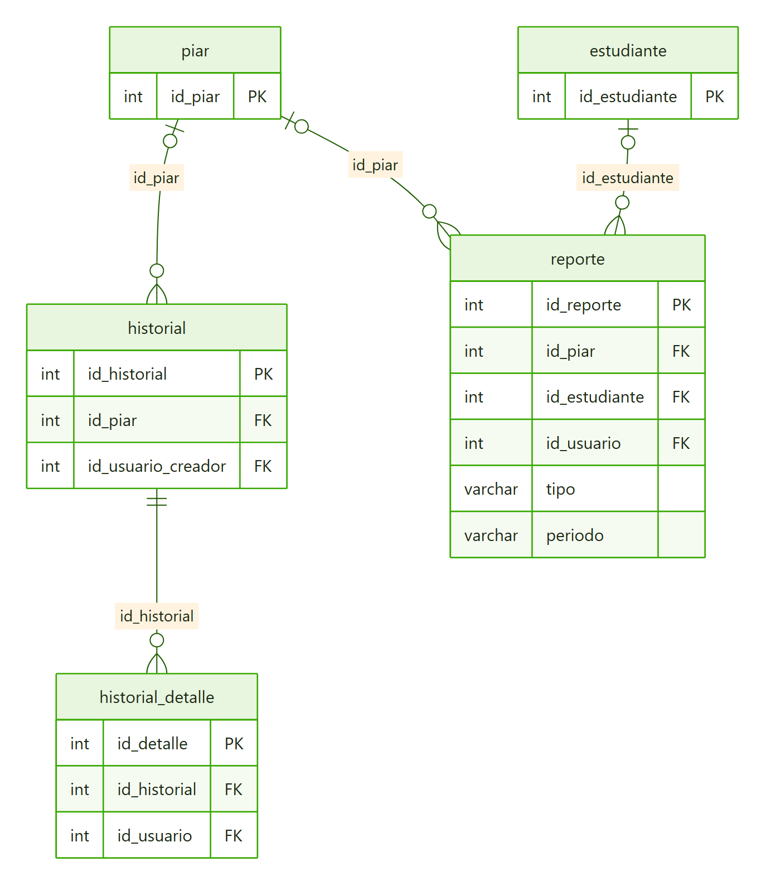
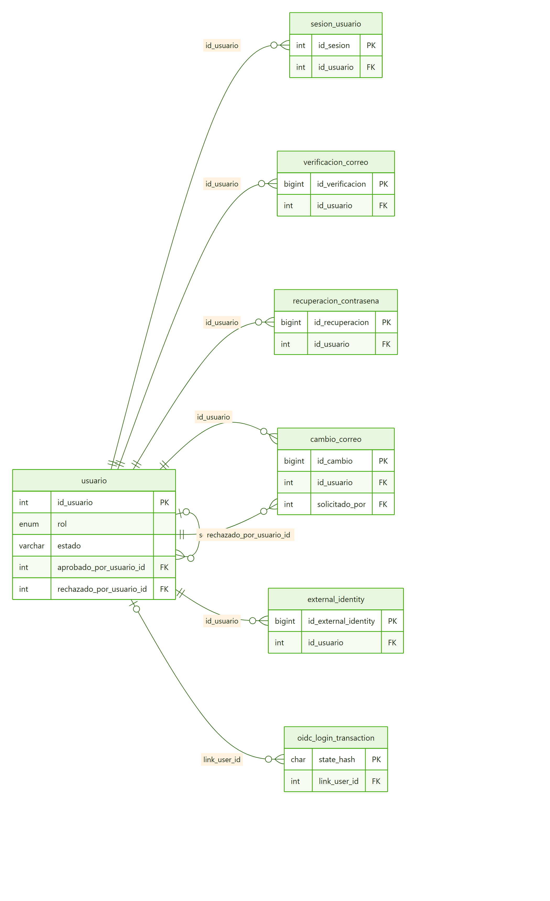
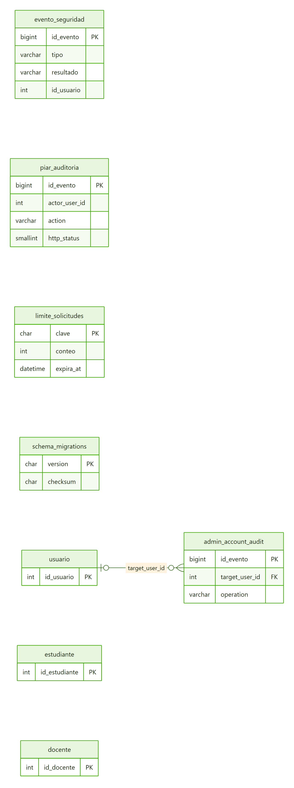

# 10. Modelo entidad-relación

<!-- sub: Entidades, relaciones y cardinalidades del esquema real -->

## 10.1 Origen del modelo

Los diagramas se generaron con `herramientas/generar-modelo-datos.js` a partir de la **estructura** de un esquema creado con las migraciones 000–016 (`piar_test_ensayo_mig`, una base de ensayo desechable). Ese esquema es idéntico en estructura al de producción: ambos tienen 28 tablas y 16 migraciones registradas. No se leyó ningún dato.

Para que los diagramas sean legibles, cada entidad muestra solo su clave primaria, sus claves foráneas y los atributos más representativos. El detalle completo está en el capítulo 11.

## 10.2 Núcleo pedagógico del PIAR

El núcleo reúne al estudiante, su PIAR, los docentes asignados y la cadena barrera → ajuste razonable → evidencia, junto con las estrategias DUA.



## 10.3 Registros de seguimiento, historial e informes

Las entidades de contexto (estudiante, PIAR, docente y ajuste) aparecen solo con su clave primaria.





Las columnas de autoría (`id_usuario_creador`, `id_usuario_registro`, `id_usuario_autor`, `id_usuario_responsable`) apuntan a `usuario`. Esas relaciones se omiten en estas vistas para no saturarlas y están en el capítulo 11.

## 10.4 Cuentas, credenciales y auditoría





Las tablas `evento_seguridad`, `piar_auditoria`, `limite_solicitudes` y `schema_migrations` no declaran claves foráneas: guardan el identificador del usuario (si lo hay) como dato, por lo que cada registro se conserva de forma independiente de la cuenta. Las tablas de control no se relacionan con otras. Las vistas completas en un solo diagrama están en `diagramas/png/13_er_pedagogico.png` y `diagramas/png/14_er_cuentas_seguridad.png`.

## 10.5 Cardinalidades principales

Tabla: Relaciones y cardinalidades

| Relación | Cardinalidad | Explicación |
|---|---|---|
| `estudiante` → `piar` | 1:N | Un estudiante tiene un PIAR por periodo; cada PIAR pertenece a un estudiante |
| `piar` ↔ `docente` mediante `piar_docente` | N:M | Un PIAR tiene varios docentes y un docente atiende varios PIAR; la tabla intermedia marca al responsable principal |
| `piar` → `piar_barrera` | 1:N | Un PIAR registra varias barreras |
| `piar_barrera` → `piar_ajuste` | 1:N (opcional) | Un ajuste puede vincularse a una barrera **del mismo PIAR**, garantizado por la clave foránea compuesta `(id_piar, id_barrera)` |
| `piar_ajuste` → `piar_ajuste_evidencia` | 1:N | Un ajuste acumula evidencias |
| `piar` → `piar_dua`, `seguimiento`, `observacion`, `diagnostico`, `reporte`, `historial` | 1:N | Registros asociados al plan |
| `historial` → `historial_detalle` | 1:N | Cada versión guarda el detalle de los campos modificados |
| `usuario` → `estudiante` | 1:0..1 | Un estudiante tiene como máximo una cuenta (`estudiante.id_usuario` es único, migración 015) |
| `usuario` → `docente` | 1:0..1 | La cuenta del docente se vincula con su perfil |
| `usuario` → `sesion_usuario`, `verificacion_correo`, `recuperacion_contrasena`, `cambio_correo`, `external_identity` | 1:N | Credenciales y sesiones de la cuenta |
| `usuario` → `usuario` | 1:N | Autorreferencia de quién aprobó o rechazó la cuenta |

## 10.6 Normalización

El esquema está en **tercera forma normal (3FN)** en sus entidades principales:

- **1FN:** todas las columnas son atómicas y cada tabla tiene clave primaria.
- **2FN:** la única tabla con clave compuesta (`piar_docente`) solo tiene un atributo propio (`es_responsable_principal`), que depende de la clave completa.
- **3FN:** los datos del estudiante, del docente y de la cuenta están en tablas propias y se referencian por clave foránea.

Hay **desnormalizaciones conscientes**, heredadas de la primera versión o necesarias para la trazabilidad:

- `estudiante` conserva `nombre` junto a `nombres` y `apellidos`, y `docente` conserva `nombre` junto a `nombres` y `apellidos`, por compatibilidad.
- `piar` conserva campos de texto (`barreras`, `estrategias`) además de las tablas `piar_barrera` y `piar_ajuste`.
- `seguimiento.responsable` y `observacion.docente_responsable` guardan texto además de la referencia al usuario.
- `historial_detalle` guarda valores anteriores y nuevos en JSON, y `reporte.contenido` guarda una instantánea: ambos son copias intencionales para auditoría.

## 10.7 Fragmento del script SQL

Sentencia `CREATE TABLE` real de la tabla de ajustes razonables, obtenida con `SHOW CREATE TABLE`:

```sql
CREATE TABLE `piar_ajuste` (
  `id_ajuste` int NOT NULL AUTO_INCREMENT,
  `id_piar` int NOT NULL,
  `area` varchar(100) NOT NULL,
  `tipo` varchar(100) NOT NULL,
  `estrategia` text NOT NULL,
  `recursos` text,
  `responsable` varchar(150) DEFAULT NULL,
  `avance` decimal(5,2) NOT NULL DEFAULT '0.00',
  `estado` varchar(20) NOT NULL DEFAULT 'activo',
  `created_at` datetime NOT NULL DEFAULT CURRENT_TIMESTAMP,
  `updated_at` datetime NOT NULL DEFAULT CURRENT_TIMESTAMP ON UPDATE CURRENT_TIMESTAMP,
  `id_barrera` int DEFAULT NULL,
  `id_usuario_responsable` int DEFAULT NULL,
  `resultado_esperado` text,
  `indicador_logro` text,
  `fecha_revision_prevista` date DEFAULT NULL,
  PRIMARY KEY (`id_ajuste`),
  UNIQUE KEY `uq_piar_ajuste_contexto` (`id_piar`,`id_ajuste`),
  KEY `fk_piar_ajuste_barrera` (`id_piar`,`id_barrera`),
  CONSTRAINT `fk_piar_ajuste_barrera` FOREIGN KEY (`id_piar`, `id_barrera`)
    REFERENCES `piar_barrera` (`id_piar`, `id_barrera`),
  CONSTRAINT `fk_piar_ajuste_piar` FOREIGN KEY (`id_piar`) REFERENCES `piar` (`id_piar`),
  CONSTRAINT `fk_piar_ajuste_responsable` FOREIGN KEY (`id_usuario_responsable`)
    REFERENCES `usuario` (`id_usuario`),
  CONSTRAINT `chk_piar_ajuste_avance` CHECK ((`avance` >= 0) and (`avance` <= 100))
) ENGINE=InnoDB DEFAULT CHARSET=utf8mb4 COLLATE=utf8mb4_unicode_ci;
```

La sentencia se abrevió: se omitieron la colación por columna y dos índices secundarios. El script completo está en `database/migrations/`.

## 10.8 Ejemplos de sentencias DML

Estas consultas reproducen, de forma simplificada, las que ejecuta el servidor. Siempre usan parámetros (`?`) y nunca concatenan valores.

```sql
-- INSERT: registrar una barrera (piar-management, POST /api/piar/:id/barreras)
INSERT INTO piar_barrera (id_piar, contexto, descripcion, fecha_identificacion, id_usuario_registro)
VALUES (?, ?, ?, ?, ?);

-- SELECT: PIAR asignados a un docente (alcance del rol Docente)
SELECT p.id_piar, p.titulo, p.periodo, p.anio, p.estado
FROM piar p
JOIN piar_docente pd ON pd.id_piar = p.id_piar
WHERE pd.id_docente = ?;

-- UPDATE: avance de un ajuste (el CHECK impide valores fuera de 0–100)
UPDATE piar_ajuste SET avance = ?, estado = ? WHERE id_ajuste = ? AND id_piar = ?;

-- DELETE: retirar la asignación de un docente
DELETE FROM piar_docente WHERE id_piar = ? AND id_docente = ?;
```

> **Nota:** el sistema no elimina estudiantes, docentes, cuentas ni PIAR. Las rutas `DELETE` de esas entidades **desactivan** el registro (`estado = 'inactivo'`) o **cierran** el plan (`estado = 'cerrado'`), para conservar la trazabilidad. Solo se eliminan físicamente los ajustes razonables, los diagnósticos y las asignaciones de docentes, y únicamente los roles autorizados pueden hacerlo.
