# 12. Módulos del sistema

<!-- sub: Funcionalidad de cada módulo, con su componente y su estado -->

## 12.1 Acceso y autenticación

- **Propósito:** identificar a la persona y abrir una sesión segura.
- **Funciones:** inicio y cierre de sesión, recuperación de contraseña, verificación del correo, cambio obligatorio de contraseña temporal.
- **Componentes:** `backend/auth.js`, `password-policy.js`, `login-throttle.js`; en la interfaz, `app.js`, `login-scene.js` y `api.js`.
- **Estado:** [IMPLEMENTADO] [PROBADO LOCAL]. En producción se verificó que el formulario envía `POST /api/auth/login` y maneja la respuesta 401 sin bloquearse [PRODUCCIÓN].

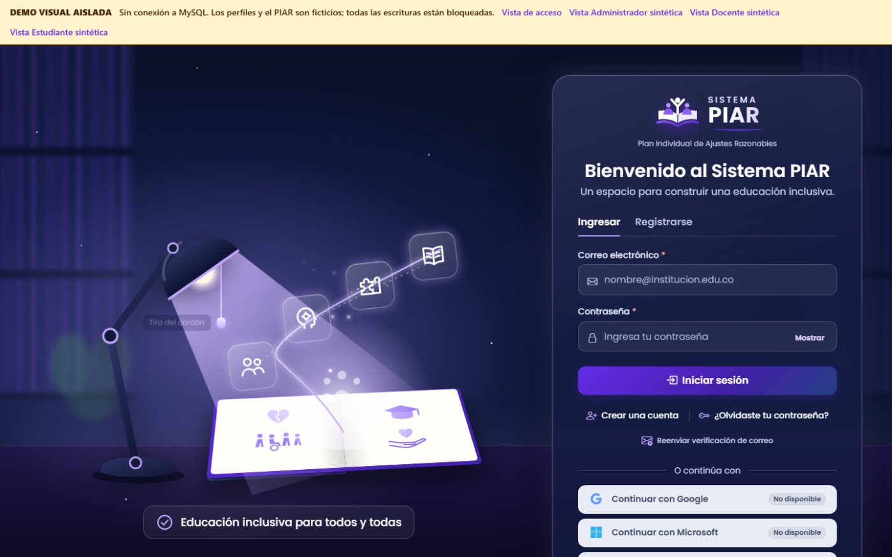

## 12.2 Registro y solicitudes

- **Propósito:** permitir que el personal solicite una cuenta y que el Administrador decida.
- **Funciones:** formulario con cuatro perfiles, verificación del correo, bandeja de **Solicitudes** con aprobación o rechazo con motivo, aviso por correo de la decisión.
- **Componentes:** `registration-approval.js`, `decision-notification.js`, `admin-account-audit.js`.
- **Estado:** [IMPLEMENTADO] [PROBADO LOCAL]. En producción depende del correo [PENDIENTE].

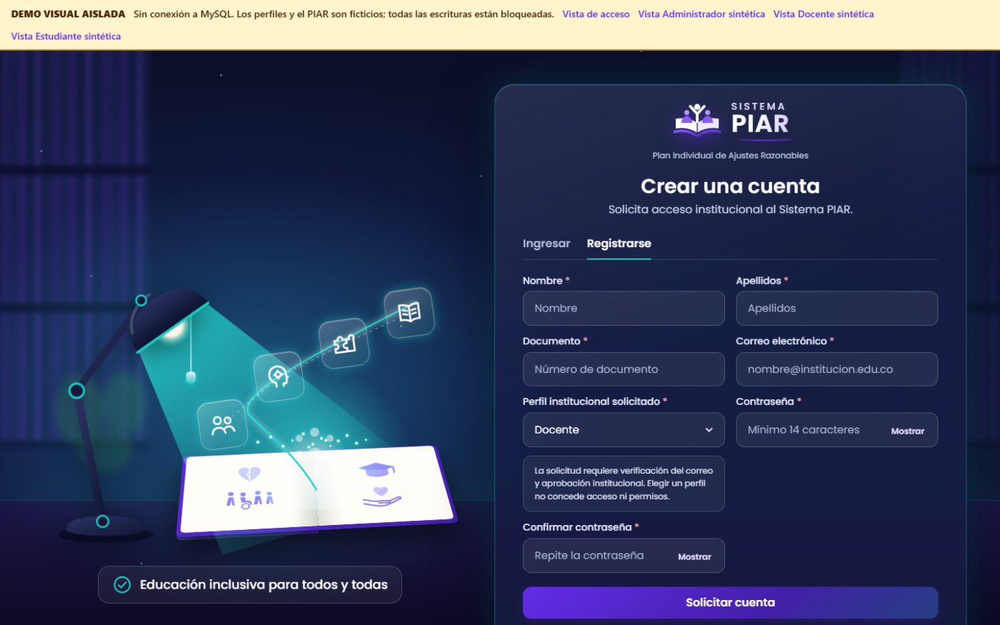

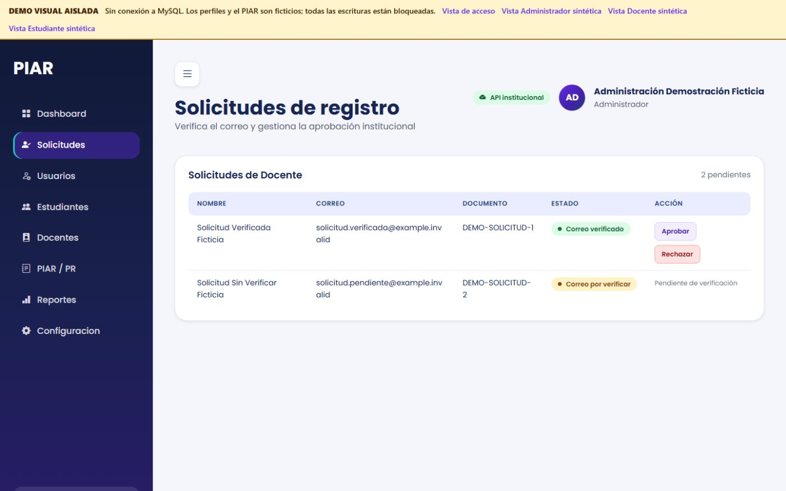

## 12.3 Administración de usuarios

- **Propósito:** gestionar todas las cuentas de la institución.
- **Funciones:** crear cuentas de personal y de Estudiante, buscar y filtrar, editar nombre y correo, desactivar y reactivar. No se puede desactivar la propia cuenta ni dejar la institución sin Administrador.
- **Componentes:** `admin-account-operations.js`, `account-email.js`; en la interfaz, `user-admin.js`.
- **Estado:** [IMPLEMENTADO] [PROBADO LOCAL].

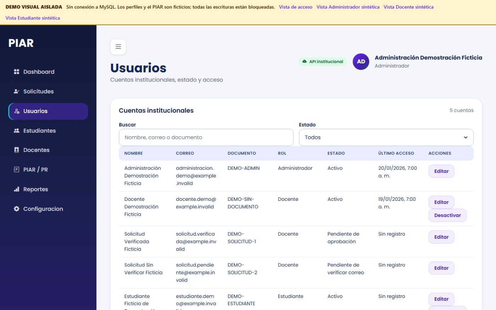

## 12.4 Tablero (dashboard)

- **Propósito:** mostrar el estado general de la inclusión en la institución.
- **Funciones:** totales, seguimientos recientes, avance promedio de los ajustes, distribución por necesidad y alertas, con gráficas de Chart.js.
- **Componentes:** `GET /api/dashboard/resumen`; en la interfaz, `app.js`.
- **Estado:** [IMPLEMENTADO] [PROBADO LOCAL].

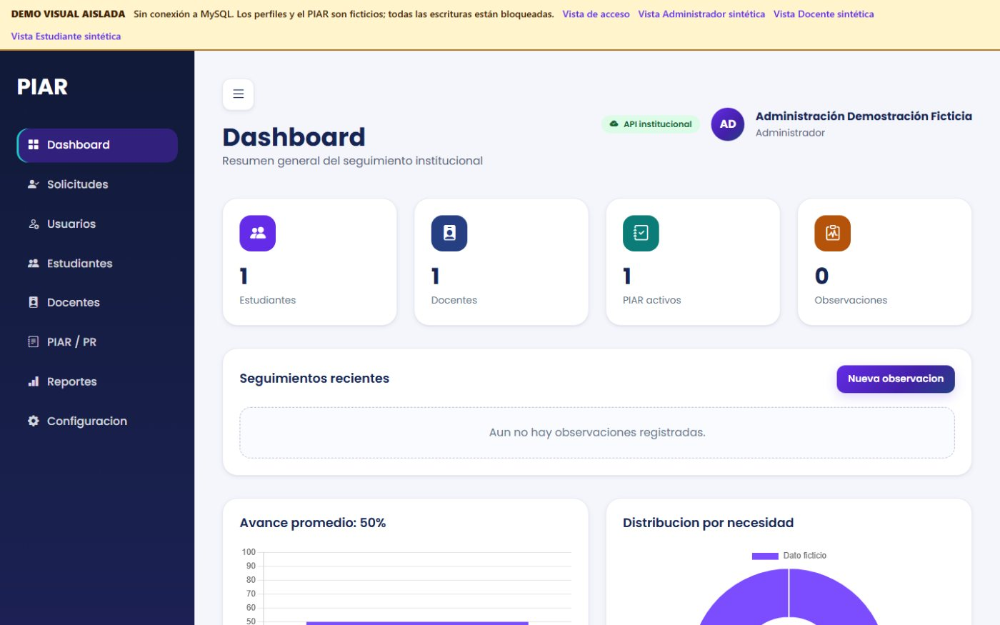

## 12.5 Estudiantes y docentes

- **Propósito:** mantener la caracterización de estudiantes y el registro de docentes.
- **Funciones:** búsqueda, perfil, alta, edición y desactivación. El Docente solo ve los estudiantes de sus PIAR asignados.
- **Componentes:** `student-update.js`, `teacher-validation.js`, `student-access.js`.
- **Estado:** [IMPLEMENTADO] [PROBADO LOCAL].

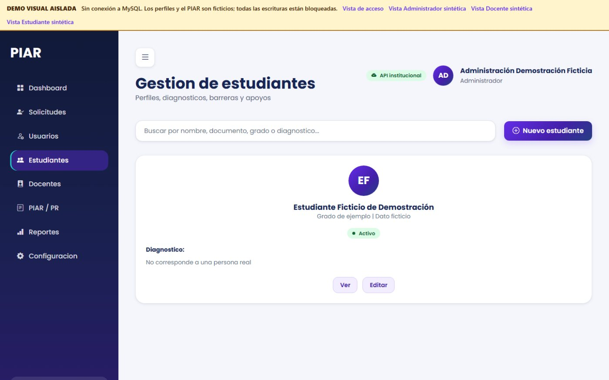

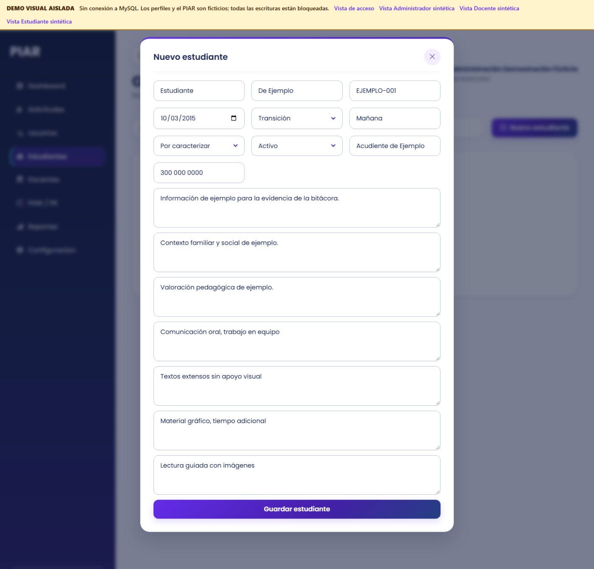

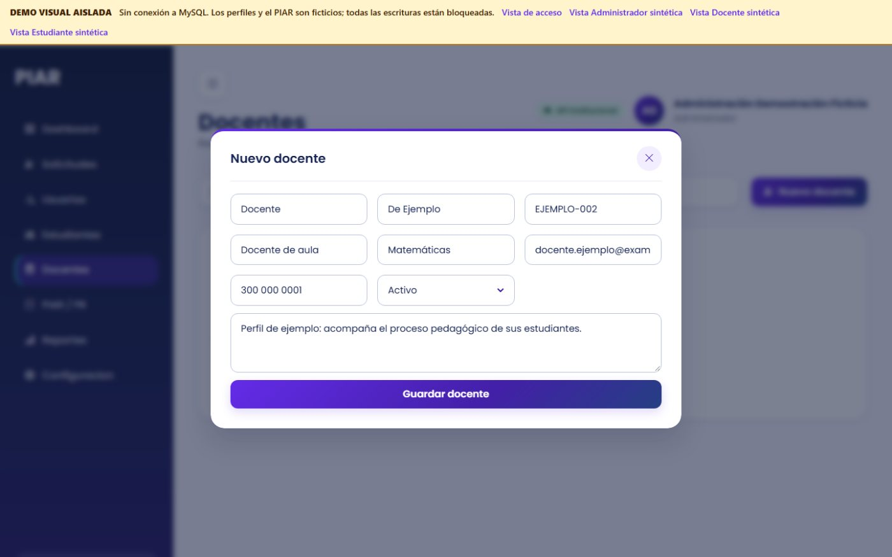

## 12.6 Gestión del PIAR

- **Propósito:** elaborar y hacer seguimiento al plan de cada estudiante.
- **Funciones:** crear el PIAR, editarlo con justificación, asignar docentes, cerrarlo, reabrirlo, consultar versiones e imprimirlo. El detalle reúne barreras, ajustes, evidencias, DUA, diagnósticos, observaciones y seguimientos.
- **Componentes:** `piar-versioning.js`, `partial-update.js`, `pedagogical-validation.js`, `pedagogical-access.js`; en la interfaz, `piar-management.js` y `piar-version-history.js`.
- **Estado:** [IMPLEMENTADO] [PROBADO LOCAL]. Sin evidencia de uso real en producción [PENDIENTE].

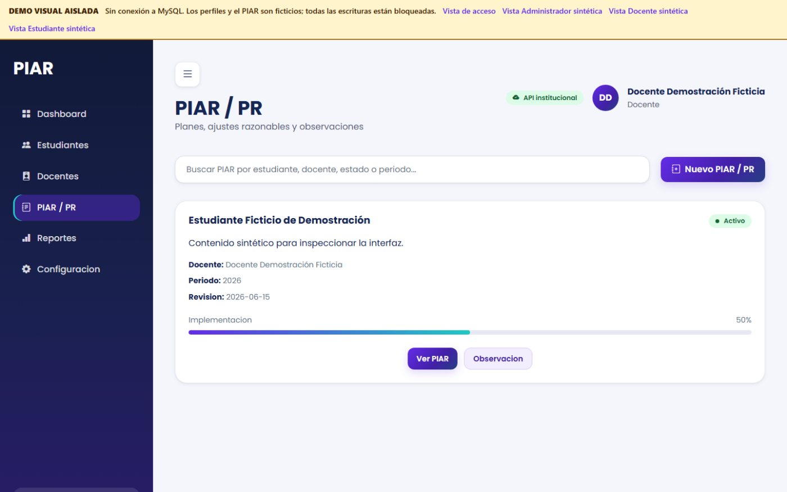

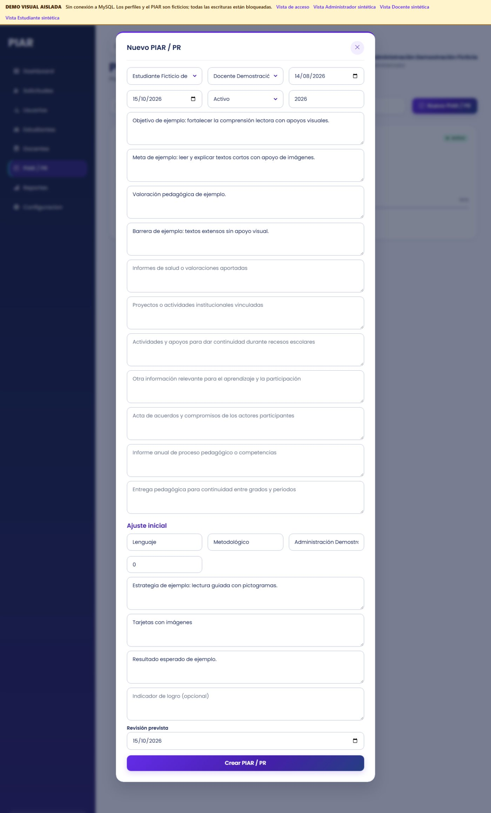

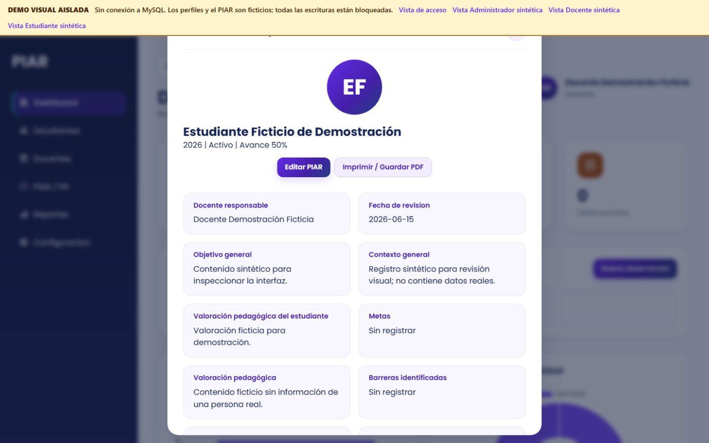

## 12.7 Barreras, ajustes, evidencias y DUA

- **Propósito:** conectar cada barrera con el ajuste que la atiende y con la evidencia de su aplicación.
- **Funciones:** registro de barreras por contexto; ajustes con barrera vinculada, responsable, resultado esperado, indicador, fecha de revisión y avance; evidencias; estrategias DUA por principio.
- **Componentes:** migraciones 008 y 013, `pedagogical-validation.js`.
- **Estado:** [IMPLEMENTADO] [PROBADO LOCAL].

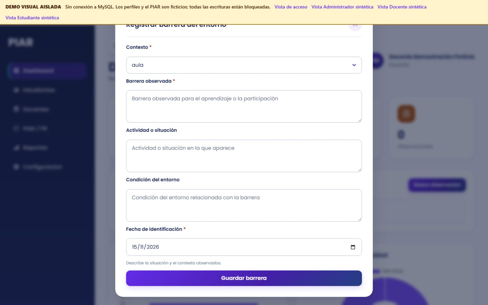

## 12.8 Diagnósticos, observaciones y seguimientos

- **Propósito:** registrar la valoración profesional y la evolución del estudiante.
- **Funciones:** los diagnósticos se crean y editan; las observaciones y los seguimientos son inmutables. El seguimiento puede enlazar un ajuste.
- **Componentes:** rutas genéricas `/api/diagnosticos`, `/api/observaciones` y `/api/seguimientos` en `server.js`.
- **Estado:** [IMPLEMENTADO] [PROBADO LOCAL].

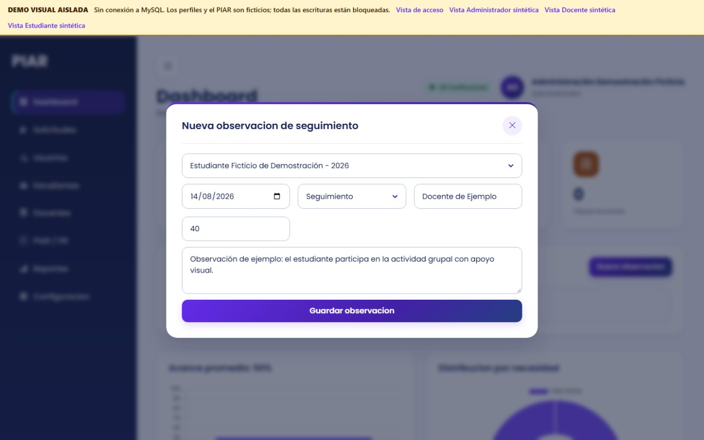

## 12.9 Reportes e historial

- **Propósito:** conservar el estado del plan en momentos clave y facilitar su entrega.
- **Funciones:** generación del informe con instantánea y hash, listado de **Informes guardados**, impresión desde el navegador, historial de versiones.
- **Componentes:** `reports.js`; en la interfaz, `report-history.js`.
- **Estado:** [IMPLEMENTADO] [PROBADO LOCAL].

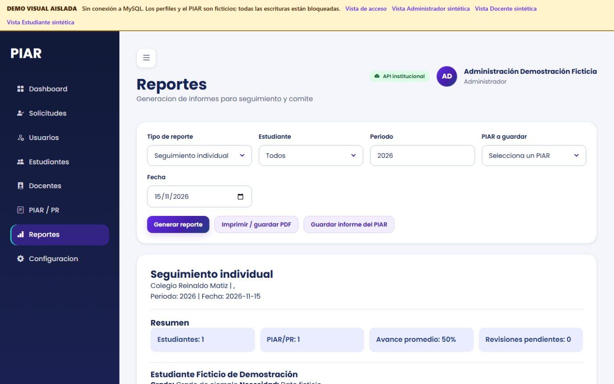

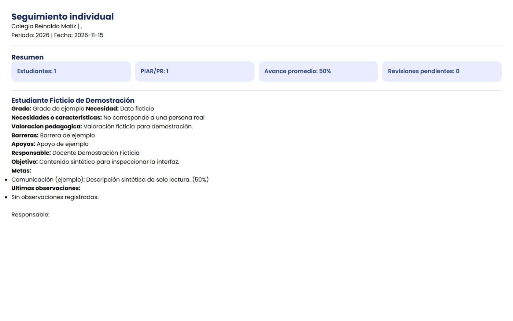

## 12.10 Portal del Estudiante

- **Propósito:** que el estudiante conozca su plan.
- **Funciones:** consulta de solo lectura de su propio PIAR, sin diagnósticos, observaciones, seguimientos ni informes de salud. Puede imprimirlo.
- **Componentes:** `student-portal.js` (servidor e interfaz).
- **Estado:** [IMPLEMENTADO] [PROBADO LOCAL].

## 12.11 Correo electrónico

- **Propósito:** entregar enlaces de verificación, recuperación, cambio de correo y avisos de decisión.
- **Funciones:** punto único de envío `deliverEmail` con transportes `resend` (API HTTPS), `smtp`, `api`, `memory` (solo desarrollo) y `desactivado`.
- **Estado:** [IMPLEMENTADO] [PROBADO LOCAL] contra un simulador de la API de Resend. En producción: `desactivado` [PENDIENTE].

> **Nota:** las capturas de este capítulo provienen de la demostración visual (`npm run demo:visual`), que usa datos **sintéticos**. No contienen información real de estudiantes.
